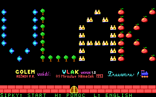
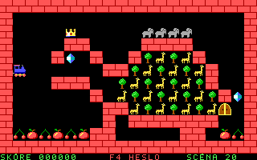

# VLAK 🚂

The little Czech train game from 1993, recreated in Rust for Windows.

Collect every piece of cargo, watch your train grow, and find your way to the
golden gate. One wrong turn, and it's **bum!** Back to the station.

**[Download VLAK for Windows →](downloads/vlak.exe?raw=true)** ·
[Controls](#controls) · [Build from source](#build-from-source) · [Credits](#credits)




## Download and play

1. [Download `vlak.exe`](downloads/vlak.exe?raw=true).
2. Save it in a folder of your choice.
3. Double-click it. Press an arrow key to leave the station.

For **64-bit Windows 10 / 11**. No Rust installation, DOSBox, installer, or extra
game files are needed. The graphics, levels, and locomotive icon are embedded in
the executable.

**Čeština je výchozí jazyk. Klávesou `L` přepnete mezi češtinou a angličtinou.**
Czech is the default language; press `L` to switch to English and back.

The downloadable binary is kept in [downloads/](downloads/), outside Cargo's
ignored build directory, so it can be committed along with the source. Its
SHA-256 checksum is in [SHA256SUMS](downloads/SHA256SUMS).

## The familiar DOS feel

- All **50 original levels**, with their original passwords and solution demos.
- The original title screen, blue locomotive, cargo, wagons, and golden gate,
  recovered from the supplied archival sprite sheets.
- A **320×200** framebuffer, sixteen EGA colors, and crisp whole-pixel scaling.
- The original **165 ms** movement interval, with adjustable speed.
- Czech and English menus, Czech diacritics, pause, restart, and saved progress.
- Double-buffered drawing and a locomotive icon for Explorer and the taskbar.

This is a new implementation. The bitmap UI font is new, the archival images
have been restored to the EGA palette, and a few missing sprite variants use
static icons. See [asset provenance](assets/README.md) for the details.

## Controls

| Key | Action |
| --- | --- |
| Arrow keys / WASD | Start and steer |
| Space / Enter | Start, pause, resume, retry, or advance after winning |
| R | Restart the current level |
| F4 / P | Enter a level number or password |
| F1 | Play the solution demo |
| Page Up / Page Down | Previous / next level |
| L | Switch Czech / English |
| + / - | Faster / slower movement |
| H | Help |
| Escape | Quit, or cancel password entry |

The game pauses when its window loses focus. Progress and language preference
are saved beside the executable as `vlak-progress.txt` and `vlak-language.txt`.
All levels are selectable. A folder you can write to lets those preferences
persist between sessions.

## Build from source

You need the stable Rust Windows MSVC toolchain and Visual Studio C++ Build Tools,
including the Windows SDK resource compiler (`rc.exe`).

```powershell
cargo build --release --locked
.\target\release\vlak.exe
```

Use `--offline` if the dependencies are already cached. The build generates the
icon from the original locomotive and embeds it automatically.

To rebuild and refresh the public download and its checksum:

```powershell
powershell -File .\scripts\package.ps1
```

Use `-Offline` on that script for a build without dependency downloads. Commit
the updated `downloads/vlak.exe` and `downloads/SHA256SUMS` with your changes.

## Extra levels

The earlier twelve custom levels are still available:

```powershell
.\downloads\vlak.exe --custom
```

You can also load an **uncompressed** DOS 2.0 `VLAK.SCN` file. Put it beside the
executable, or pass its path:

```powershell
.\downloads\vlak.exe 'C:\Games\Vlak\VLAK.SCN'
```

Use the scene file from the original source package, rather than the compressed
`VLAK$.SCN` from the DOS distribution. The 50 bundled original levels need no
external files.

## Development checks

```powershell
cargo test --locked
cargo clippy --locked -- -D warnings
```

Tests play every original and custom solution to completion and check collisions,
cargo growth, scene importing, original sprites, Czech glyphs, and controls.

Native-resolution screenshots can be exported without opening a game window:

```powershell
.\downloads\vlak.exe --preview scene20.bmp 20
.\downloads\vlak.exe --preview-title title.bmp
```

## Credits

**Miroslav Němeček** created the original **Vlak** in 1993: the game design,
programming, graphics, and levels. This recreation exists because he preserved
and shared that work. Visit [the author's Vlak page](https://www.breatharian.eu/sw/vlak/index.html)
for the original releases, source archives, and history.

The original scene layouts come from his
[SCENY.ASM source](https://github.com/Panda381/DOS-Progs/blob/main/HRY/VLAK/V100/SOURCE/SCENY.ASM).
Passwords and solution demos come from his
[MACRO.TXT](https://www.breatharian.eu/sw/vlak/dwn/MACRO.TXT).
Historical sprite sheets and the title reference were supplied for this project.

The Rust recreation was developed with assistance from **OpenAI Codex**.
Thanks to everyone keeping small Czech games and their history alive.

## License

The Rust implementation is [MIT licensed](LICENSE). Original game material
remains credited to Miroslav Němeček and is reused under the permission stated
on [his website](https://www.breatharian.eu/sw/vlak/index.html), which allows use
of the supplied sources, graphics, and sounds for any purpose, including
commercial use. [Asset credits and provenance](assets/README.md) are recorded
separately.
